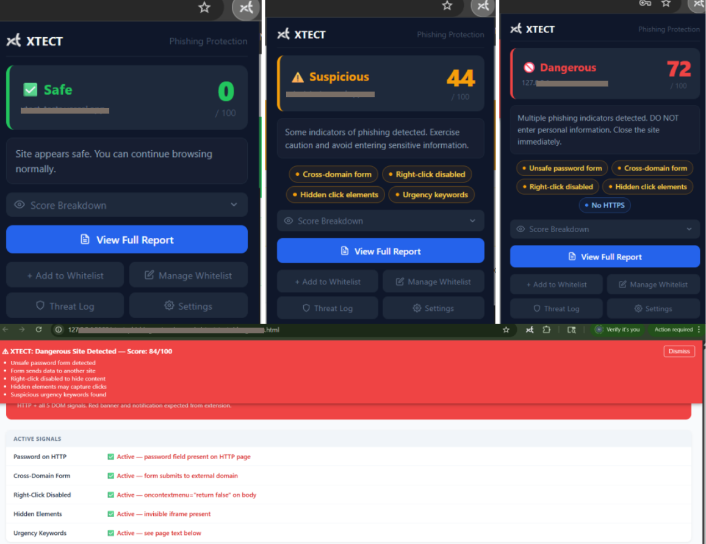
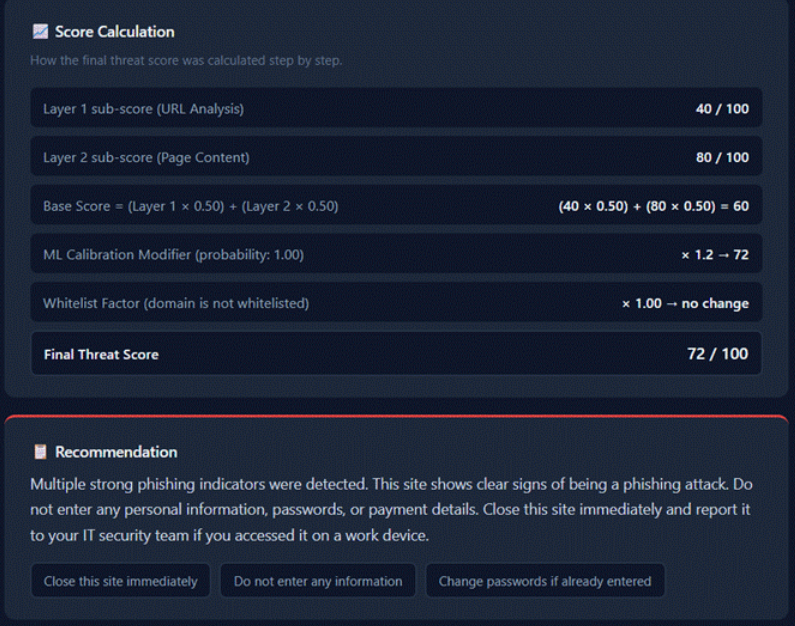

# XTECT - Ensemble-Based Chrome Extension for Multi-Layer Phishing Detection

**Project type:** Collaborative academic capstone  
**Industry context:** Philippine insurance industry  
**Organization:** Anonymized Philippine insurance company  
**Platform:** Google Chrome Extension and Administrative Web Dashboard  
**My focus:** Research, requirements analysis, feature planning, Chrome extension testing, dashboard monitoring and testing, evaluation, and technical documentation

> **Portfolio and confidentiality note:** This repository is a sanitized academic case study. The organization is anonymized, and identifying organizational connection details have been removed from the included screenshots. Do not add internal URLs, credentials, private employee information, unpublished organizational records, or confidential deployment details.

 1. Project overview

XTECT is a collaborative academic capstone project that aimed to strengthen phishing threat detection and browser security for employees of a Philippine insurance company.

The team developed a Google Chrome extension that integrates multiple detection approaches, including URL Analysis, DOM Inspection, and whitelist Verification. These mechanisms contribute to an ensemble-based threat assessment that presents users with risk classifications, scoring information, and explainable alert interface.

An accompanying administrative web dashboard supports centralized monitoring and management.

This repository documents the project at a portfolio level. It does not contain the source code of the complete system and does not claim that I personally programmed or implemented the extension or dashboard.

## 2. Detection approach

The thesis describes the following detection and assessment components:

- **URL intelligence:** Checks whether a URL appears in known phishing or malware sources and considers connection encryption.
- **Page content analysis:** Inspects webpage structure and content for selected patterns associated with phishing.
- **Whitelist and impostor detection:** Checks trusted-domain status and looks for domain impersonation patterns.
- **Ensemble risk scoring:** Combines detection signals into a unified score.
- **Explainable results:** Presents classifications, signal breakdowns, and recommendations to help users understand the assessment.

The screenshots in `evidence/` illustrate the user-facing interface and examples of report explanations.

## 3. My contributions

My confirmed contributions included:

### Research and project planning
- Conducted research and literature review.
- Contributed to identifying the phishing problem and project requirements.
- Participated in planning system features.
- Contributed to the development of the manuscript across all documented chapters.

### Chrome extension testing
- Executed assigned test cases by operating the Chrome extension.
- Compared actual behavior against expected results.
- Recorded pass/fail outcomes.
- Captured screenshots of successful test executions.
- Identified unexpected behavior and communicated potential issues to the developer with supporting screenshots.

### Dashboard monitoring and testing
- Viewed and monitored reported phishing threats and threat logs.
- Checked detected domains and their risk scores.
- Reviewed dashboard reports, statistics, and security summaries.
- Participated in testing administrator functions and dashboard features.
- Checked whether information generated by the Chrome extension appeared correctly on the dashboard.
- Compared dashboard information against expected results.
- Helped evaluate dashboard usability through feedback.

### Evaluation and documentation
- Helped consolidate feedback and evaluation forms from organizational participants.
- Helped in the calculation, analyzation, summarization of testing results, and technical documentation. 

**Scope clarification:** I participated in hands-on testing of the Chrome extension and monitoring/testing activities involving the administrative dashboard. Lead team member handled the vibe coding,programming, and implementation of the chrome extension and dashboard. I do not claim to have personally coded or implemented those components.

## 4. Project-level testing results

The thesis reports the following results for the overall project:

| Iteration | Reported outcome |
|---|---|
| Iteration 1 | 250 of 257 items passed (97.28%); seven failures were documented |
| Iteration 2 | Retesting was conducted after the development team addressed the seven initial findings |
| Iteration 3 | 273 of 273 executed test cases passed (100%) |

The thesis also reports the following Iteration 3 solution-validation measurements:

| Metric | Reported result |
|---|---:|
| Detection accuracy | 98.17% |
| Precision | 97.64% |
| Recall | 98.10% |

These are team/project-level results reported in the capstone thesis. They must not be presented as measurements produced independently by me or as proof of universal detection effectiveness. Refer to the thesis for test scope, methodology, acceptance criteria, and limitations.

## 5. Evidence
## Chrome Extension Interface



**Figure 1. Chrome Extension Interface.**
The XTECT Chrome extension presents website risk classifications, numerical threat scores, and security indicators to help users recognize potentially malicious webpages. 
It provides contextual warnings and recommendations based on the detected indicators.

## Multi-Layer Threat Detection



**Figure 2. Multi-Layer Threat Detection and Explainable Risk Assessment.**
XTECT combines URL and threat-intelligence analysis, DOM-based webpage inspection, and whitelist verification. 
These detection signals contribute to an ensemble-based risk assessment, with machine-learning calibration and explainable scoring presented in the report.

## 6. Learning outcomes

Through my participation, I gained experience in:
- Researching phishing threats and detection approaches.
- Translating a cybersecurity problem into project requirements.
- Preparing and executing functional test cases.
- Comparing expected and actual system behavior.
- Recording test outcomes and preserving evidence.
- Monitoring dashboard threat logs, flagged domains, reports, and security statistics.
- Testing dashboard features and comparing displayed information against expected results.
- Consolidating user feedback and evaluation forms.
- Analyzing and summarizing testing results.
- Communicating findings to the group's lead development teammate.
- Preparing technical documentation and presenting a cybersecurity project.

## 7. Project limitations and responsible interpretation

XTECT is an academic prototype. Its results should be interpreted within the scope and limitations documented in the thesis. A risk score is an assessment, not a guarantee that a website is safe or malicious. The tool should not be represented as replacing organizational security controls, endpoint protection, or user judgment.

This case study is a portfolio summary, not a claim of independent implementation, a professional penetration test, or production security certification.

## 8. Repository contents

```text
xtect-phishing-detection-case-study/
├── README.md
├── docs/
│   └── CONTRIBUTIONS.md
└── evidence/
    ├── extension-interface/
    │   ├── xtect-extension-1.jpg
    │   └── xtect-extension-2.jpg
    └── threat-assessment/
        ├── xtect-report-3.jpg
        ├── xtect-report-4.jpg
        └── xtect-report-5.jpg
```

## 9. Academic source
The technical descriptions and project-level results in this case study are based on the team's capstone thesis:

*An Ensemble-Based Chrome Extension for Multi-Layer Threat Detection to Mitigate Phishing Threats in an Insurance Organization.*

The public portfolio version intentionally anonymizes the organization. The complete thesis should not be uploaded publicly unless the team and relevant organization have authorized its release.
